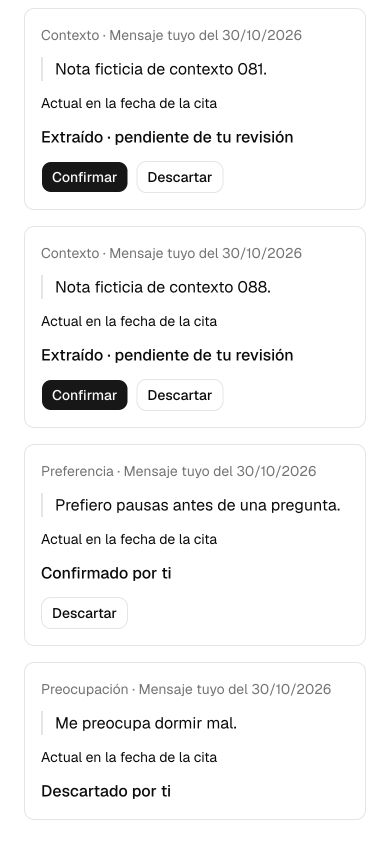

# Perfil progresivo: aceptación técnica local

Actualizado el 30 de octubre de 2026. **Implementación, revisión global, corrección de hallazgos y aceptación técnica local completadas.** Este documento no acredita diagnóstico, calidad semántica del modelo ni aprobación clínica.

Rama `codex/progressive-patient-profile`, base `11ec2c2`. Último commit de producto probado: **`e14a9b7584fb47296b29be3f4032606d3a665934`**. [Spec](../superpowers/specs/2026-10-28-progressive-profile-design.md), [plan](../superpowers/plans/2026-10-28-progressive-profile.md). El perfil no se ha publicado ni ha aplicado migraciones remotas; sin datos reales, modelos externos ni cambios de dependencias o del modelo configurado. `FEATURE_PROGRESSIVE_PROFILE` continúa apagado por defecto; requiere además activación explícita del usuario. La publicación independiente del piloto0.2/11ec2c2 y el correo a Pablo del30octubre **excluyen este perfil**; [su recibo](../handoff/para-pablo-piloto-2026-10-30/README.md) no se reutiliza como aceptación del perfil.

## Comportamiento entregado

Citas literales de mensajes guardados, categoría, fecha, referencia temporal y procedencia; extracción separada de la respuesta del chat mediante cola duradera. El extractor recibe instrucciones de excluir hipótesis y atribuciones ajenas; su comprensión aún necesita evaluación semántica. SQL sólo admite citas literales de fuentes con rol de usuario y no promueve esas observaciones a conclusiones clínicas. Una observación pendiente o confirmada por la persona conserva esa etiqueta; ninguna equivale a revisión de Pablo.

«Lo que recuerda Serenia» permite activar/desactivar memoria y confirmar/descartar citas. Una corrección pendiente impide presentar el dato disputado como confirmado. Confirmarla sustituye el dato previo; si ya fue descartado, permanece descartado. Desactivar impide nuevas extracciones y contexto, conservando las citas revisables; no borra conversaciones ni puede deshacer una petición de modelo ya iniciada. No incorpora retrospectivamente mensajes antiguos.

Todas las citas retenidas son alcanzables por páginas propias de100 mediante «Ver citas anteriores» y «Volver a citas recientes». El cursor preserva fecha de fuente e ID, incluidos microsegundos y empates; la disputa se calcula aunque la corrección esté en otra página. Los límites del extractor y del contexto permanecen iguales. Seleccionar un enlace del menú móvil cierra el drawer y deja ver el destino.

## Evidencia final30octubre

| Comprobación | Resultado y evidencia privada |
| --- | --- |
| Siete gates sobre e14a9b7 | PASS,1.056pruebas/85archivos, lint,tipos,wire,SQL,audit y build. `.cache/pablo-pilot/logs/20261030-163628-ib5eavsx.log`; `/var/folders/3q/lq4c_t8s06v_jc64x_vv3f980000gn/T/serenia-verify-f8lJPN/results.json`: siete exits0 |
| Audit y wire nativos | Producción/full0advisories;20payloads previos y24roundtrips; logs completos en ese directorio |
| Supabase local real | `db:verify` PASS `20261030-163317-awywx65r.log`, tras la nueva migración y generación exacta de tipos; no hubo cambio de esquema posterior |
| Build de aceptación | PASS `20261030-163628-te3a_co7.log`, snapshot `/var/folders/3q/lq4c_t8s06v_jc64x_vv3f980000gn/T/serenia-build-fgYvYE/project`, fuentee14a9b7, BUILD_ID `38NOx7roefCVaukcyxjif`, mismo lock y versiones de la tabla histórica |
| SQL de historial |205filas propias/203empatadas,100/100/5, oldconfirmed+pending, ACL/owner, cursor exacto, fin/empty, disputa fuera de página y revisión obsoleta; gateSQL completo PASS. RED por RPC ausente `20261030-162721-_cq6idj4.log`; GREEN focal `20261030-163108-sbefg78k.log` |
| Auth/DataAPI/HTTP de historial | Actor nuevo con107citas/105fuentes empatadas. Cien recientes ocultan las dos antiguas, pero nueva RPC recorre100+7 sin pérdidas/duplicados; owner ajeno, grants, cursores inválidos y precisión real comprobados. `20261030-221312-2xpddllc.log` |
| Navegador finale14 | Móvil390×844: seleccionar perfil cierra menú; enlace anterior alcanza oldpending+confirmed; corrección fuera de página muestra disputa; segundo dispositivo confirma oldpending; confirmar desde UI obsoleta produce aviso inmediato; recarga lo retira y muestra confirmado; descartar oldconfirmed persiste y se muestra descartado; volver a recientes conserva100tarjetas y elimina el aviso de éxito de la página anterior |
| Target real antes/después | Antes del descarte, Workflow generado relaciona la corrección con la antigua confirmada: `20261030-221609-f9gqg7si.log`. Tras descarte por UI, la siguiente extracción completa sin referenciar ese target;109citas totales, dos runs reales y0jobs de cierre en la sesión nueva: `20261030-221715-paz9gsdr.log` |
| Pasada integral nueva final | Actor nuevo: activar→mensaje→pending→confirmar→corrección/disputa→confirmar→contexto corregido→replay→optout→contexto ausente→reactivar sin backfill. Cuatro jobs,0cierres; `20261030-221312-seywcded.log` |
| I/O durable real final | SDK hidrata4runs/4steps de la pasada limpia y2runs/2steps de historial; sólo IDs/token/estados/contadores, sin fuentes/citas. `20261030-221647-dk6vmugs.log` y `20261030-221749-klds_97q.log` |

La [revisión global](2026-10-30-profile-final-review.md) encontró I1/P2: las citas anteriores a100 desaparecían del control del usuario pero seguían siendo targets del worker. La única ola de corrección añade `get_profile_memory_page`, controles y regresiones. La [revisión scoped](2026-10-30-profile-final-fix-review.md) da I1 y M1 por resueltos, sin nuevas rupturas Critical/Important; conserva las dos excepciones P3. El agente revisor guardó el informe completo antes de terminar su turno con límite de uso: se inspeccionó el artefacto íntegro, sin inventar otro veredicto ni duplicar la revisión.

La pausa por límite de uso hizo expirar la sesión de preparación del actor de historial. El acceso normal la cerró y se creó otra desde la UI, conservando fuentes y sesión cerrada; no se reabrió ni se ocultó el tiempo transcurrido. Log `20261030-221456-8tsqa57g.log`. En el tooling privado, dos escrituras concurrentes del manifiesto de fixtures perdieron sólo el registro del nuevo actor HTTP. El primer wire falló por actor undefined (`20261030-221424-rw45ktu8.log`), sin mutar producto. Se recuperó ese registro a partir de los UUID Auth/sesión/observaciones exactos del ensayo y se verificaron sus cuatro runs, sin repetir mensajes/jobs: `20261030-221547-sa95lptb.log` y wireGREEN posterior. Se conservaron ambos fallos y se serializaron las mutaciones siguientes.

Captura de la prueba ficticia tras recuperar el historial y descartar la cita antigua:

Nueva migración **`20261030152754_profile_memory_history_page.sql`**, SHA256 `c9cc722dd713d6ee209f65b77b3ef912e2ae732443c8bdad424b2fa7c9293c6d`, aplicada sólo localmente con preflight/identidad y fuente exacta, preservando48versiones previas, catálogo y datos;49versiones después. Apply `20261030-163246-t4t8yln1.log`; tipos `20261030-163258-np591iyk.log`. No se reescribieron las tres migraciones de perfil anteriores ni se repararon gaps históricos. [Auditoría de requisitos y límites](2026-10-30-profile-completion-audit.md).

## Fallos encontrados y corregidos

1. **Confirmar tras descartar el original.** La revisión independiente detectó una corrección pendiente que no podía confirmarse después de descartar su target. La migración forward `20261028180058` resuelve la transición sin reactivar el original ni versiones sustituidas.
2. **Revisión bloqueada en Guardando.** La prueba real descubrió que nuestros conflictos deterministas usaban SQLSTATE `40001`, que provoca reintentos internos en PostgREST 14.5. La [nota oficial de Supabase](https://supabase.com/kb/troubleshooting/high-cpu-and-infinite-transaction-retries-when-using-custom-error-codes-in-rpc-functions) describe el problema. La migración `20261028185351` cambia sólo cuatro raises de las tres RPC nuevas a `PT409`; la acción muestra un conflicto recuperable. Se preservaron API, locks, estado, owner, grants y metadatos. No se cambió React ni el SDK para ocultar el problema.
3. **Aviso retenido tras recargar.** La recarga actualizaba los datos pero conservaba el mensaje de conflicto del cliente. El evento de recuperación ahora consume ese aviso. Regresión con el mismo componente montado y prueba real: recargar actualiza el estado, retira el aviso y no afirma un guardado inexistente.

Las suites SQL con shim de Auth y los mocks de acciones **no detectaron por sí solos el bucle de PostgREST**. Los resultados previos de tests se conservan como evidencia previa, no como aceptación final de esa ruta. Antes del retest se detuvo sólo el servidor sintético propio y se terminaron únicamente backends identificados de las solicitudes ficticias; todas las observaciones se conservaron. No hubo reinicio general ni borrado de cuentas/datos.

## Historial de aceptación29octubre, antes de la paginación

| Comprobación | Resultado y evidencia privada |
| --- | --- |
| Siete gates `npm run verify` sobre 896ff37 | PASS,1.032 pruebas en 85 archivos; lint,tipos,wire,SQL,audit y build. `.cache/pablo-pilot/logs/20261029-222511-a3qg3vm_.log`; directorio completo `/var/folders/3q/lq4c_t8s06v_jc64x_vv3f980000gn/T/serenia-verify-6RHL7z` |
| Auditoría de dependencias | Producción y grafo completo:0 advisories de todos los niveles, en la consulta de ese gate |
| Workflow wire |20 payloads anteriores y24 roundtrips actuales;0 fallos |
| Supabase real `db:verify` | PASS lint/advisors/comparación exacta de tipos, log `20261029-222009-3r5ri6cy.log`. Ejecutado tras la última migración; el cambio posterior sólo afecta al botón y su test |
| Build de aceptación local | PASS sobre 896ff37, log `20261029-222422-56z0qm3r.log`; BUILD_ID `vvSSkWGn9PpKGbeaxisPA` |
| Lock y runtime | SHA256 `cb963dbb3901c1f91e74c86c979e68062a823c464383250f72f95f7d26c9a425`; Node 24.14.1, Next 16.4.1, React 19.3.1, AI 6.0.303, Workflow 4.8.13 |
| Conflictos PostgREST reales | Revisión obsoleta, start duplicado y fallo tras completar: HTTP 409 / PT409 en 6/3/4 ms; límite de 4 s no alcanzado. Log `20261029-221513-p5tp7iy3.log` |
| Backend tras conflictos |0 revisiones no-idle en bucle, comprobado tras el recorrido final |

Se mantiene el `TimeoutNaNWarning` conocido de la suite sintética; no se describe su salida como libre de warnings ni se afirma corregido. La CLI fijada 2.120.0 avisa de 2.122.0 disponible; no se cambió durante este objetivo.

## Auth, API, Workflow y navegador

Auth/JWT y PostgREST reales del stack local identificado `serenia-dev`, Next de producción aislado y proveedor sintético del harness. Credenciales de estado local sólo en memoria; sin `.env.local` ni proveedores externos. Pruebas propias con actores nuevos `example.test`, nunca cuentas reales. Scripts/recibos privados en `.cache/profile-acceptance/` y `/private/tmp/serenia-profile-20261028/`.

- **Permisos/consentimiento:** anónimo sin RPC; usuario sin jobs/workerRPC/escritura directa; otro owner sin citas ni revisión ajenas; cita literal y fuente propias; replay sin duplicados; desactivar invalida tokens de trabajo running; reactivar no recupera trabajos ni mensajes anteriores. Log inicial `20261028-191113-n47eyi__.log`; la ruta de conflicto lento detectada después se sustituyó y se volvió a probar con PT409.
- **Recorrido de navegador incremental:** activación; mensaje→cita pendiente→confirmación; corrección con cita anterior y disputa visible; descartar corrección conserva el original confirmado; confirmar después de descartar el original; nueva cita y cambio desde otro dispositivo; conflicto explícito→recarga sin aviso residual; desactivar→descartar una cita conservada; siguiente turno sin contexto/trabajo. Primeras acciones en e2ef15a, corrección/contexto en 67aa0af, recuperación y retirada finales en 896ff37. No se atribuye todo el recorrido a un único artefacto anterior al fix.
- **Correlación final de ese actor:**7 turnos completados,1 intento por turno,6 jobs completados y4 observaciones con fuentes literales propias. Las cuatro terminaron descartadas por decisiones deliberadas del ensayo, después de comprobar la confirmación/contexto corregido.0 jobs de cierre y sesión abierta: la memoria no depende de disponer de informe. Log `20261029-222724-3mpouc8z.log`; contexto corregido previo `20261029-221946-d3rinu2n.log`.
- **Pasada integral limpia en el artefacto final 896ff37:** actor nuevo, Auth/API y endpoints Workflow generados; extracción→confirmar→corrección→confirmar→contexto actualizado→replay sin duplicados→desactivar→contexto ausente→reactivar sin backfill.4 jobs completados y0 jobs de cierre. Log `20261029-223011-o4mdrnw7.log`. Esta pasada usa RPC de revisión reales; las acciones de interfaz se comprobaron además en el recorrido de navegador.
- **I/O durable real:** SDK instalado hidrata inputs/outputs ligados al job/token.6 runs + 6 steps del navegador y4 runs + 4 steps de la pasada limpia contienen sólo IDs,token,estados y contadores; no fuentes ni citas. Logs `20261029-222723-8nvuuayt.log` y `20261029-223022-17eipjr6.log`.

Los indicadores del preload comprueban presencia/ausencia de la cita ficticia original/corregida sin registrar prompts.0 denegaciones de red en la evidencia hasta la correlación de navegador; la prueba limpia conserva el mismo límite de red/proveedor. No se midió naturalidad de las respuestas del modelo real.

Un trabajo quedó inicialmente sin despachar y el siguiente turno lo recuperó; no se forzó manualmente su terminación. No se identifica la causa con certeza; coincidió con las solicitudes de conflicto bloqueadas. Se mantiene el respaldo de cola/cron y no se promete latencia inmediata. El cron diario de respaldo no se ejecutó como parte de esta aceptación; sus guards y despacho acotado tienen tests.

## Migraciones y procedencia

Aplicadas sólo al stack local las tres versiones nuevas `20261028081958`, `20261028180058`, `20261028185351`, registrando sus fuentes exactas. Las dos primeras permanecen byte-idénticas tras la tercera. Última SHA256 `9fbff95d4afaa1c4076fca09674a0c601db86af9b69b4ff3e35a7acfdf342827`; aplicación/proveniencia `20261028-195745-d41y75e8.log`. Regresiones incluyen 18 casos de drift de las tres rutinas, rollback y preservación completa de metadatos. Tipos idénticos al generador fijado; una línea de whitespace generado permanece como excepción explícita.

Los huecos previos del historial local `20261013073246`, `20261013213559`, `20261024145433` no se repararon ni se afirma que esas versiones se aplicaran desde sus archivos. El lint/advisors/tipos actual pasa; eso no reconstruye el historial. No hubo reset, reparación inventada ni aplicación hospedada.

## Límites y siguiente revisión

[Casos ficticios para Pablo](../handoff/para-pablo-piloto-2026-10-25/perfil-progresivo-casos.md): terceros, negaciones, historia, preferencias, acuerdos ambiguos, citas ajenas y correcciones. Falta ejecutar y valorar esos casos con el modelo real y Pablo; confirmar por la persona no valida clínicamente la información. No hay medición de precisión diagnóstica ni de atribución semántica.

Las fricciones anteriores de compositor/reintento, cuestionarios, cierre y lectura final siguen en [la revisión del recorrido](2026-10-27-session-journey-ux-review.md); este incremento no las resuelve. El drawer móvil observado el29octubre se corrigió en la ola final y se volvió a comprobar el30. Publicación del perfil, aceptación hospedada y aprobación clínica/legal siguen fuera de esta aceptación local.

## Decisiones tomadas durante la implementación

1. Rama local separada en el checkout autorizado, conservando el trabajo anterior. Coste: habría que coordinar ediciones humanas simultáneas sobre ese mismo checkout.
2. Contador de trabajos agotados por el consentimiento vigente, además de pendientes, para explicar fallos sin exponer errores. Coste: consumidores del DTO deben respetar ese contrato.
3. Fuentes inmutables y desvinculación de una referencia antigua borrada, conservando la fuente correctora independiente. Coste: una futura edición de mensajes debe crear una nueva intervención trazable.
4. Permitir confirmar la corrección tras descartar el original, manteniéndolo descartado y resolviendo siblings. Coste si la asociación fuera incorrecta: el usuario podría confirmar un vínculo erróneo; se muestra la cita anterior y se mantienen los guards/versiones.
5. Conservar el whitespace del generador oficial de tipos. Coste: un warning de diff conocido, a cambio de paridad exacta comprobada.
6. Usar migraciones forward protegidas sin reescribir fuentes ya aplicadas ni inventar historial. Coste: más pasos de migración que deberán verificarse antes de publicar.
7. Mostrar la cita anterior con una consulta adicional propia y acotada cuando falta en la proyección. Coste: si no está disponible se informa de la limitación; nunca se inventa.
8. Conflictos de negocio `PT409` en las tres RPC nuevas. Coste: consumidores deben interpretar HTTP409/PT409; los cambios conservan firmas, permisos y transiciones. El inventario de migraciones no encontró otros custom40001 anteriores del proyecto.
9. Publicar y enviar a Pablo sólo la base estable11ec2c2 mientras el perfil aún tenía un hallazgo abierto. Coste: el perfil necesitará otra ronda de prueba cuando se autorice su publicación; no se presenta el correo enviado como prueba de esta funcionalidad.
10. Nueva RPC de historia con páginas de100 y cursores precisos, preservando presupuestos de extracción/contexto. Coste: otro contrato/migración y coordinación de tipos; empates, precisión y ownership requieren regresiones.
11. Incluir el cierre mínimo del drawer compartido en móvil. Coste: posible regresión en navegación de escritorio/teclado, cubierta por tests de los cinco destinos y prueba móvil del perfil.
12. Archivar con hashes el workspace SDD de este plan antes de retirarlo de su ubicación activa, conservando en Git los dos informes finales. Coste: el detalle privado completo ocupa disco y no se transporta sólo con Git; se mantiene la evidencia de fallos exigida por el proyecto.
