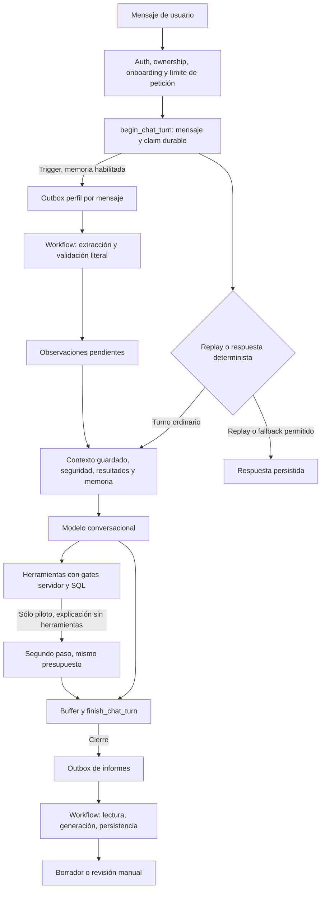

# Arquitectura de IA de Serenia: inventario y refactor mínimo propuesto

Fecha: 1 de noviembre de 2026. Fuente inspeccionada: `/Users/miguelluque/git/serenia`, HEAD `915c8e2edfaf991ca13b8d55b389a5952d06f8e6`. **Auditoría de código y documentación; propuestas NO IMPLEMENTADAS.** No se han cambiado código, modelos, configuración, dependencias, migraciones ni servicios. No se han leído secretos o `.env.local`, consultado cuentas remotas, ejecutado modelos ni realizado pruebas de runtime. La única escritura de este trabajo es este documento.

**Recomendación:** conservar AI SDK 6 + Workflow y los contratos SQL existentes. Separar las políticas de conversación, extracción de perfil e informe; medir llamadas y reintentos completos; corregir primero las ambigüedades de recuperación y contexto. Evaluar un modelo pequeño para extracción antes de plantear un supervisor, subagentes, Decisions en producción o una migración a Eve. El ahorro potencial viene de la frecuencia, el contexto reenviado y los intentos, además de la tarifa del modelo.

La inspección de fuente describe comportamiento implementado, no configuración desplegada ni aceptación clínica. Los bloqueos de release actuales pertenecen a la auditoría principal: este estudio no levanta el gate de dependencias, no autoriza merge a main, no renueva una confirmación Supabase caducada ni demuestra que el paquete de perfil esté aplicado.

Actualización de implementación posterior al inventario:2b149e4 corrige ACK y d4b39e8 separa políticas por tarea, elimina retriesSDKcompuestos y sanea errores de generación. Ambas revisiones independientes están aceptadas; no se cambiaron modelos productivos. Ver [revisión de políticas](../audits/2026-11-01-task-model-policy-review.md). Las demás propuestas siguen pendientes.

## 1. Qué componentes existen realmente

| Componente | Naturaleza real | Modelo y frecuencia | Estado persistente / autoridad |
| --- | --- | --- | --- |
| `/api/chat` | Bucle de herramientas muy acotado: el modelo elige texto/herramientas, el servidor limita y autoriza | `llm.conversational()`, una generación por turno ordinario; piloto permite un segundo paso de explicación | `chat_turns`, mensajes, propuestas y RPCs de cierre/cuestionarios; no memoria privada de un agente autónomo |
| Informe de cierre | Pipeline durable de pasos predeterminados, con una llamada estructurada y recuperación | `llm.structured()`, al cerrar/regenerar, con reintentos | `assessment_jobs` y `assessments`; salida `draft_ai` o `requires_manual_review`, revisión humana posterior |
| Perfil progresivo | Worker durable de extracción estructurada; no planificador ni herramientas del modelo | También `llm.structured()`, por cada mensaje de usuario admitido con memoria habilitada | Jobs por fuente, citas literales, estado pendiente/confirmado por la persona; nunca confirmación clínica |
| Contexto de paciente y perfil | Lectura y selección determinista, sin modelo adicional | En cada turno admitido que llega a generación, según flags | Informes revisados/borradores diferenciados, resultados, riesgo, tareas, intake y citas de perfil |
| Seguridad, puntuaciones, permisos y temporización | Código/SQL determinista, más instrucciones de conversación | Ningún clasificador LLM en el camino de autorización | Auth/ownership, consentimiento, reglas de cuestionarios, leases/tokens, cierre y revisión |
| Auxiliar Decisions/Jev | Adaptador experimental desconectado; sólo transporte inyectable | Sin consumidor paciente ni transporte real implementado en el módulo | `off` por defecto, `shadow_review_only`; no persiste ni decide acciones |

No hay `ToolLoopAgent`, delegación entre agentes, supervisor LLM, planificador autónomo, vector store ni un agente distinto por dimensión clínica en el código inspeccionado. Las cuatro herramientas del chat pertenecen al mismo bucle. Llamar «agentes» a los workers no añade autonomía: su orden de trabajo está fijado por código.

Evidencias: [chat](../../app/api/chat/route.ts):44–310; [workflow de informe](../../lib/server/workflows/generate-assessment.ts):55–111; [workflow de perfil](../../lib/server/workflows/extract-profile.ts):8–64; [auxiliar](../../lib/server/llm/auxiliary.ts):35–62. La búsqueda de consumidores de `generateAssessment()` sólo encontró su definición y pruebas; el helper de [generator.ts](../../lib/server/assessments/generator.ts):101 sigue existiendo, pero no se cuenta como una segunda llamada de producción. Contiene una implementación heredada con límites distintos y conviene evitar su reintroducción accidental.

El diagrama resume el flujo; un replay ya completado no vuelve a finalizar ni generar. El trigger de perfil depende del consentimiento guardado; el despacho además depende del flag/allowlist. La existencia del SQL en fuente no acredita su aplicación remota.

## 2. Contratos, presupuestos y cadencia observados

### Conversación

- Auth `getUser`, sesión/conversación propia y onboarding vigente preceden al claim. El cliente sólo aporta **un** mensaje `user` de texto, no historial ni instrucciones de sistema: 24.000 bytes por petición y 6.000 caracteres por mensaje. [request-boundary](../../lib/server/chat/request-boundary.ts):3–24; [route](../../app/api/chat/route.ts):44–75.
- `begin_chat_turn` admite/persiste primero. El servidor reconstruye historial ordenado desde BD, consulta hasta 161 filas y rechaza el exceso, comprueba presencia del mensaje admitido y aplica límites de 160 elementos y 80.000 caracteres JSON. El límite conjunto incluye sistema; no equivale a 80.000 tokens. [route](../../app/api/chat/route.ts):118–159.
- Contexto: prompt versionado de referencia/piloto, riesgo, aviso de seguridad, cuestionarios, tiempo, intake, continuidad/fase y perfil opcional. Si el perfil hace exceder el presupuesto, sólo ese bloque opcional se retira y se vuelve a comprobar el presupuesto. [system-prompt](../../lib/server/chat/system-prompt.ts):43–54.
- `streamText`: timeout 45 s, `maxRetries:0`, máximo 2.500 tokens de salida; función HTTP `maxDuration:60`. Referencia: 1 paso. Piloto: máximo 2, descontando salida usada del presupuesto total; el segundo tiene `toolChoice:'none'` y `activeTools:[]`. Los pasos revalidan tiempo y tamaño. El piloto serializa herramientas y exige texto tras sus resultados. [route](../../app/api/chat/route.ts):180–231.
- Herramientas: `propose_close_session`, `confirm_close_session`, `close_session_crisis`, `propose_questionnaire`. Confirmación de cierre usa consentimiento textual determinista y RPC; una llamada del modelo no constituye autorización. Las instancias de cuestionarios mantienen sus gates de disponibilidad/prioridad. [route](../../app/api/chat/route.ts):233–257.
- El stream se acumula en memoria y se persiste **antes de enviarse** al cliente; máximo 100.000 caracteres de chunks JSON. Así se evita mostrar un asistente que no quedó guardado. No es streaming incremental visible durante la generación. [route](../../app/api/chat/route.ts):260–294.
- Seguridad: detección léxica y estado guardado preceden al modelo; el piloto solicita lecturas estrictas. Hay respuestas deterministas para ramas urgentes/tiempo y fallos de generación con señal de crisis. Una escritura final ambigua conserva recuperación y nunca se sustituye por una respuesta distinta como si hubiera tenido éxito. [route](../../app/api/chat/route.ts):94–176,295–310; [safety-state](../../lib/server/chat/safety-state.ts):28–30,88–103.
- La sesión tiene máximo 60 minutos e inactividad de 30. El contrato SQL permite hasta tres intentos de turno y leases de dos minutos; `maxRetries:0` del SDK no significa «sólo una llamada durante toda la vida del turno». [session-time](../../lib/shared/chat/session-time.ts):1–12; [contrato SQL](../../supabase/migrations/20261010123627_robust_chat_questionnaires_recovery.sql):193–226.

### Informe y cierre

- Cierre por chat, servicio de sesión o recuperación crea/recoge outbox; la regeneración clínica reutiliza el flujo con contexto de rechazo. `loadClosedSession` → idempotencia → generación → persistencia; error terminal de generación → revisión manual. [dispatch](../../lib/server/workflows/index.ts):10–36; [closeSession](../../lib/server/sessions/service.ts):129–163.
- El generador durable exige al menos tres mensajes de usuario; carga los mensajes visibles de la conversación, verifica ownership y rechaza **más de 60 mensajes o 80.000 caracteres de filas JSON**, sin truncar silenciosamente. Añade resultados y respuestas de ítems, eventos de riesgo y eventual contexto de rechazo. Estos bloques adicionales y el sistema no tienen un presupuesto agregado explícito en esa función. La consulta de transcript tampoco tiene `.limit()` en BD. [generate-assessment](../../lib/server/workflows/generate-assessment.ts):214–319.
- `generateObject`: 6.000 tokens de salida y timeout de 45 s. No fija `maxRetries`, por lo que usa el default **2** comprobado en `node_modules/ai/src/util/prepare-retries.ts:41`; el paso Workflow fija `maxRetries=3`. Eso permite hasta **4 ejecuciones del paso × 3 intentos SDK = 12 intentos proveedor** por serie de reintentos, si los errores son reintentables y caben en los timeouts. Es un límite teórico de composición, no uso medido ni garantía de que todos se ejecuten o facturen. Los rechazos `FatalError` no siguen ese recorrido. [generate-assessment](../../lib/server/workflows/generate-assessment.ts):313–330.
- El outbox añade hasta cinco claims, lease inicial 10 minutos, running 30 minutos y backoff 5 minutos al fallar despacho. La capacidad global SQL es **dos jobs de informe activos**, aunque el handler solicite hasta diez. No multiplicar automáticamente 12×5 como consumo normal: generación terminal suele finalizar con revisión manual; las reclamaciones cubren fallos/leases. [SQL](../../supabase/migrations/20261010123627_robust_chat_questionnaires_recovery.sql):307–369.
- Las puntuaciones/bandas/flags se recargan de fuente autorizada y reemplazan el campo generado antes de persistir. Mantener esta separación de hechos y prosa. La finalización tokenizada comprueba sesión cerrada, claim y lease; genera borrador, nunca revisión humana. [generate-assessment](../../lib/server/workflows/generate-assessment.ts):252–281,328,345–347,541–544.
- **Punto a probar:** el dispatch de informe captura conjuntamente error de `start()` y error de su ACK SQL; ambos ejecutan `failed`. El dispatch de perfil ya separa esos casos y no resetea un worker cuando `start()` tuvo éxito. No se afirma pérdida observada; falta prueba de interleaving con worker ya iniciado/completado y ACK fallido. [assessment dispatch](../../lib/server/workflows/index.ts):14–27 frente a [profile dispatch](../../lib/server/profile/dispatch.ts):15–30.

### Perfil

- Trigger `after insert on messages`: una fuente por mensaje de usuario, sólo con memoria personal habilitada. `ON CONFLICT(source_message_id)` evita duplicación. No hay clasificador previo ni lote semántico de mensajes. El chat despierta un job en `after()`, el worker despierta el siguiente y el cron recupera. [SQL perfil](../../supabase/migrations/20261028081958_progressive_profile.sql):89–103; [route](../../app/api/chat/route.ts):76–80.
- Procesamiento en orden por usuario: no saltar una fuente anterior esperando backoff o lease. Hasta tres claims, lease dos minutos, backoff 30 segundos; workers de distintos usuarios pueden progresar. La concurrencia de dos `start()` por llamada de dispatch no es una cuota global del modelo de perfil. [claim SQL](../../supabase/migrations/20261028081958_progressive_profile.sql):182–209; [dispatch](../../lib/server/profile/dispatch.ts):35–62.
- Entrada: sólo texto canónico del mensaje y hasta 20 observaciones **confirmed** anteriores. Fuente hasta 8.000 caracteres Unicode; cada cita guardada hasta 400. Salida hasta cinco observaciones, 1.500 tokens, timeout 20 s, SDK y paso Workflow con cero reintentos propios. [extractor](../../lib/server/profile/extractor.ts):6–61; [workflow](../../lib/server/workflows/extract-profile.ts):32–64.
- Validación: citas literales, duplicados, categoría y corrección a target confirmado; SQL revalida fuente, ownership, epoch de consentimiento, token y lease atómicamente. Completado/replay/claim obsoleto no vuelve a llamar al modelo. No se serializan errores SDK crudos al historial durable. [workflow](../../lib/server/workflows/extract-profile.ts):23–61; [SQL](../../supabase/migrations/20261028081958_progressive_profile.sql):215–286.
- El contexto lee memoria mediante RPC; selecciona pending y confirmed no disputadas, prioriza correcciones, coincidencia léxica y recencia; hasta ocho citas/4.000 caracteres. `confirmed` significa confirmado por la persona, nunca revisado por clínico. Es memoria eventual: la extracción puede acabar después del turno que la originó. [context](../../lib/server/profile/context.ts):7–50.
- El flag global y allowlist Vercel se suman al consentimiento personal. El estado deployed de esos controles no fue consultado. [config](../../lib/server/profile/config.ts):8–25.

### Recuperación y observabilidad

`vercel.json` programa `/api/internal/close-stale-sessions` a `0 8 * * *`: **una vez al día**. El handler cierra hasta diez sesiones, recupera/reclama informes con capacidad global dos y despacha hasta diez perfiles, de dos en dos. Un fallo después del último mensaje puede esperar a otro evento o al cron; el backoff de 30 segundos/5 minutos sólo hace elegible un job, no garantiza que se despache entonces. La cadencia configurada es observable en fuente; su ejecución real no se verificó. [handler](../../app/api/internal/close-stale-sessions/route.ts):13–47.

La telemetría es desigual: informe registra `usage` de generación exitosa; chat usa salida por paso para presupuesto, sin registro uniforme de uso total; perfil descarta `usage`; el auxiliar devuelve contadores mínimos. El [estimador](../../lib/shared/llm/candidates.ts):25–40 distingue desconocido de cero, pero no está conectado al runtime. No hay evidencia aquí para afirmar coste, p95, tasa de reintento, caché efectiva o calidad semántica reales.

## 3. Contexto y coherencia que conviene resolver

1. **Snapshot documentado frente a lectura real.** El comentario de [builder](../../lib/server/patient-context/builder.ts):103–119 promete un tier congelado por sesión, pero [route](../../app/api/chat/route.ts):135–142 llama al builder en cada turno; éste no usa `sessionId` para congelar nada (:145–147). Ejecuta diez consultas paralelas (:150–258). Por tanto, una revisión clínica entre turnos puede cambiar el contexto. No hay snapshot transaccional único entre esas consultas. Primero definir si se quiere lectura fresca o continuidad estable; no implementar un caché que congele permisos, riesgo o retirada de consentimiento.
2. **Información durable y memoria eventual.** Mensaje, cuestionarios, informe y perfil tienen momentos de persistencia distintos. La selección de citas pending no vuelve esas citas verdad clínica, y una extracción vacía no significa «sin problemas». Un refactor debe conservar procedencia, fecha y estado de revisión al componer contexto.
3. **Presupuesto de informe distinto al de chat.** Un chat válido puede superar 60 mensajes y terminar en revisión manual por tamaño. Debe ser un resultado explícito del producto, no resolverse aumentando límites o truncando evidencia sin diseño. Añadir presupuesto agregado antes del proveedor permite controlar también ítems, riesgo, notas y sistema.
4. **Errores del informe.** [workflow](../../lib/server/workflows/generate-assessment.ts):93–102,383–387 persiste `err.message`; a diferencia de perfil, no hay sanitización equivalente antes de los límites durables. Probar con error sintético que contiene un marcador privado y normalizar códigos seguros sin perder la causa operativa necesaria. Es una exposición potencial según tipo de error, no una filtración demostrada.

## 4. Selección de modelos por tarea

[models.ts](../../lib/shared/llm/models.ts):3–14 construye `provider/model`; [config.ts](../../lib/shared/llm/config.ts):8–15 exige `LLM_<ROLE>_MODEL`, usa `anthropic` sólo como default de proveedor y no implementa fallback automático entre modelos. `.env.example:14–19` propone Sonnet 4.6 para conversación/informe y Haiku 4.5 para `fast`: **plantilla, no lectura del deployment**. `fast()` no tiene consumidores en `app/` ni `lib/`; cambiarlo hoy no ahorra llamadas. Ninguna opción `providerOptions` de routing, razonamiento o fallback está fijada en las tres llamadas activas inspeccionadas. La configuración Gateway de cuenta permanece desconocida.

Fuentes primarias abiertas el 1 de noviembre; tarifas base USD por millón de tokens, no resultados de Serenia:

| Tarea propuesta | Candidatos para prueba | Tarifa entrada/salida | Criterio de adopción |
| --- | --- | --- | --- |
| Conversación en español con herramientas | GPT-6.1 Sol y Claude Sonnet 5.5, contra referencia actual verificada al ejecutar la evaluación | 2 / 10 ambos | Calidad de conversación, no inventar acuerdos, herramientas correctas, respuesta posterior a herramienta, límites de salida y seguridad; coste por sesión aceptable |
| Informe para revisión clínica | Misma comparación, con contrato de informe propio | 2 / 10 ambos | Fidelidad a transcript, negaciones, cronología, ítems no preguntados, hechos deterministas intactos y edición requerida por clínico |
| Extracción de citas de perfil | GPT-6 Luna y Claude Haiku 5.5 | 0,10 / 0,50 en los tramos cortos documentados | Cita exacta y sujeto correcto, temporalidad/negación, correcciones, abstención, sin diagnósticos inferidos; coste y latencia de toda la cadena |
| Etiquetas auxiliares sólo en sombra | Decisions GPT-6 Luna; Jev con versión explícita | 0,10 / 0; 0,042 / 0 respectivamente, caché según endpoint | Sólo si existe una pregunta útil y dataset etiquetado; nunca autorización, scoring o desactivación de una alerta |

[Sol](https://developers.openai.com/api/docs/models/gpt-6.1-sol) requiere Responses para herramientas y documenta razonamiento `low` a `max`. [Luna](https://developers.openai.com/api/docs/models/gpt-6-luna) admite `none` y otros niveles; sus restricciones de herramientas dependen del endpoint. Esto exige verificar la ruta efectiva **AI SDK → Gateway → proveedor**: Gateway puede traducir protocolos, así que una restricción de API directa no prueba por sí sola incompatibilidad del Gateway instalado.

[Sonnet 5.5](https://platform.claude.com/docs/en/models/sonnet-5-5/overview) documenta cambios de herramientas forzadas, thinking y parámetros de muestreo. [Haiku 5.5](https://platform.claude.com/docs/en/models/haiku-5-5/overview) es candidato nuevo respecto al estudio local de octubre: está orientado a extracción/clasificación; su tarifa 0,10/0,50 aplica hasta 100.000 tokens de entrada, con tramos superiores más caros. Su tokenizador difiere del de Haiku 4.5. No se presupone su disponibilidad en nuestra cuenta/Gateway ni compatibilidad del esquema instalado.

**Decisión propuesta:** empezar por medir y separar `profileExtraction` de `closureReport`, manteniendo inicialmente el mismo modelo para demostrar que el refactor no cambia comportamiento. Después comparar Luna/Haiku en extracción. Para conversación/informe, Sol/Sonnet son candidatos, no ganadores medidos. No añadir un router LLM por turno para escoger entre ellos: añade otra llamada, estado y superficie de fallo sin beneficio probado.

El coste debe sumar todos los pasos, intentos, razonamiento facturable, lecturas/escrituras de caché y fallos con uso disponible. Para N turnos ordinarios sin fallo, el número de generaciones es aproximadamente `N + T + P + R`: T turnos piloto con continuación por herramientas, P mensajes extraídos, R informes/regeneraciones. No incluye reintentos ni ramas deterministas sin modelo. Si perfil está habilitado, P puede acercarse a N. Reenviar todo el historial hace crecer la entrada total aproximadamente de forma cuadrática con N hasta los límites; el segundo paso reenvía contexto adicional. Son relaciones de la arquitectura, no mediciones.

## 5. AI SDK/Workflow, Decisions y Eve: qué resuelve cada uno

| Opción | Qué aporta | Encaje propuesto en Serenia |
| --- | --- | --- |
| AI SDK 6.0.303 + Workflow 4.8.13 actuales | Generación/herramientas y pasos durables ya integrados con contratos de dominio | Conservar; aislar adaptadores y políticas sin reemplazar las máquinas de estado SQL |
| OpenAI Decisions | Respuestas tipadas a predicados, elecciones y rúbricas; no produce una conversación ni sustituye una transacción | Experimento auxiliar independiente sólo si aporta utilidad verificable |
| AI SDK `experimental_decide` | Abstracción común de decision models, con capacidades distintas según proveedor | No está en el grafo actual; estudiar en una actualización separada, nunca copiar ejemplos v7 a v6 sin comprobar compatibilidad |
| Eve | Runtime de sesiones y bucle de agente durable, herramientas/canales/estado y delegación | No adoptar ahora: obligaría a reconciliar su estado de sesión/turno con el estado clínico y los fences ya existentes |

[Decisions oficial](https://developers.openai.com/api/docs/guides/decisions) ya se documenta como GA, con `POST /v1/decisions` y Luna; entrada 0,10/M, salida sin cargo, caché de lectura/escritura facturada. Elegibilidad ZDR/región no acredita nuestra configuración. No convertir sus probabilidades en certezas clínicas.

La [guía AI SDK Decisions](https://ai-sdk.dev/docs/ai-sdk-core/decisions) es v7, distingue decisiones nativas de adaptaciones mediante salida estructurada. La [nota oficial de transición](https://vercel.com/i/ai-sdk-evaluation-to-decisions) identifica `ai` 7.0.128+ y carácter experimental. Es una diferencia de integración concreta, no motivo automático para actualizar el proyecto.

La [documentación de durabilidad de Eve](https://eve.dev/docs/concepts/execution-model-and-durability) ofrece sesiones que sobreviven reinicios y despliegues. Su [investigación Jev](https://github.com/vercel/eve/blob/main/research/jev-decision-models.md) describe `auto`/`decide` sobre la API de decisiones del SDK. Ese routing no demuestra mejoras para Serenia. Adoptar Eve sólo tendría sentido ante una necesidad nueva medible —trabajo prolongado, canales o delegación— que el sistema actual no cubra a coste razonable, con prueba de que no aparece una segunda autoridad sobre cierre, revisión, consentimiento o mensajes.

La [referencia TypeSafe actual](https://docs.typesafe.ai/models) ya hace apuntar `jev-latest` y `jev-preview` a **1.14**, a diferencia de [la nota local del 23 de octubre](../audits/2026-10-23-model-refresh.md):26. El auxiliar local sigue fijando `jev-1.13.0`; no se ha cambiado. TypeSafe indica que inglés obtiene su mejor precisión, por lo que el español exige evaluación propia. Conservar IDs/versiones registradas evita cambios silenciosos por alias.

## 6. Refactor mínimo: interfaces y orden propuesto

Las siguientes interfaces son contratos de diseño, **no código implementado ni nueva autoridad clínica**. No requieren servicios nuevos, clases de agente, framework nuevo ni un scheduler LLM.

| Prioridad | Interfaz/límite propuesto | Responsabilidad y resultado verificable |
| --- | --- | --- |
| P1 | `resolveTaskPolicy(task)` con `task = conversation | profileExtraction | closureReport` | Modelo/adapter efectivo, versión de prompt/esquema, timeout, output/context budget y dueño del retry. Al principio proyecta la configuración existente sin cambiar modelos. El rol `fast` no se activa de forma implícita. |
| P1 | `generateProfile(input, policy, signal) -> { observations, usage, model }` y equivalente `generateClosure` | Adaptadores puros de generación: sin credenciales en argumentos durables, sin escrituras DB ni decisiones de permisos. Validación del esquema y cita permanece separada; el worker existente conserva claim, consentimiento y commit. |
| P1 | `recordModelAttempt(event)` | Evento minimizado: task, versión/prompt hash, modelo solicitado/resuelto cuando disponible, intento/paso, duración, estado, contadores de uso nullable. Sin texto, citas, tokens de claim o errores SDK crudos. No registrar cero cuando falta uso. |
| P1 | `dispatchClaimedJob(claim) -> started | start_unknown | ack_pending` | Distinguir «no arrancó» de «arrancó, ACK falló». Reutilizar token/fences y replay existentes; demostrar que un ACK fallido no reabre ni pisa un worker activo/completado. No introducir fallback que permita escribir sin claim. |
| P2 | `buildTurnContext(ownedSession, admittedMessage) -> { blocks, versions, budget }` | Separar bloques obligatorios de opcionales y devolver procedencia/versiones. Fijar explícitamente contrato de continuidad entre turnos; seguridad, ownership, consentimiento y resultados que cambian requieren lectura vigente. |
| P2 | `prepareClosureEvidence(session, claim) -> { evidence, budget, outcome }` | Un único camino de preparación con límite conjunto y resultado `manual_review_required` cuando falte evidencia o exceda presupuesto. Conservar todos los hechos autorizados y revisión humana. Retirar o hacer inequívocamente interno el helper heredado tras demostrar ausencia de consumidores. |
| P2 | `recoverDueJobs(now, capacity)` | Mantener SQL como dueño de disponibilidad, capacidad, tokens y orden. Medir edad de cola y definir cadencia de recuperación que cumpla un objetivo acordado, independiente del último mensaje. No aumentar concurrencia sin medir cuotas/coste. |
| P3 | `evaluateAuxiliaryShadow(input, candidate)` | Mantener el resultado separado del contexto de autorización. Adoptar sólo con utilidad, calibración española, política de datos y coste comparativo acreditados. No necesaria para el refactor anterior. |

Para reintentos de informe, propuesta técnica inicial: un dueño explícito, preferiblemente Workflow con SDK `maxRetries:0`, preservando el número máximo de intentos durables decidido y el estado de revisión manual. Antes de adoptar, probar errores transitorios, agotamiento, timeout, reinicio y lease perdido; no quitar recuperación para conseguir una cifra de coste menor.

Para perfil, no agrupar mensajes ni saltarse textos mediante un clasificador en esta primera fase. Esas optimizaciones cambian procedencia, orden y correcciones. Medir antes la proporción de extracciones vacías, tamaño de los 20 targets y latencia; una política posterior de selección debe demostrar que no elimina correcciones, negaciones o retirada de consentimiento. El ahorro por modelo pequeño puede obtenerse sin cambiar la unidad durable por mensaje.

## 7. Pruebas necesarias y límites de esta auditoría

1. **Contrato sin proveedor real:** transporte sintético de chat con cero/una/varias herramientas, segundo paso sin herramientas, usage ausente/inválido, presupuesto agotado, deadline durante generación y error tras herramienta ya persistida. Verificar chunks/estado DB y replay, no sólo el texto. Extender las pruebas existentes de `tests/chat` conservando sus reglas.
2. **Reintentos y ACK:** contar llamadas de transporte por combinación SDK/Workflow; inducir `start` exitoso + ACK perdido con worker en running/completed; recuperar lease y rechazar token anterior; no regenerar al reejecutar un paso ya durable. Empezar en [outbox.test](../../tests/workflows/outbox.test.ts) y [workflow de informe](../../tests/workflows/generate-assessment.test.ts); los mocks no bastan para replay durable real.
3. **Perfil y semántica:** duplicado de dispatch, replay, retirada de consentimiento entre generar/guardar, corrección concurrente, orden por usuario y backoff tras último mensaje. Corpus español con negación, pasado, terceros, cita ajena, corrección explícita, ausencia de datos y texto adversarial. La literalidad del substring no valida sujeto/temporalidad: requieren etiquetas humanas y comparación de modelos. Reutilizar `tests/profile` y las verificaciones SQL existentes.
4. **Contexto:** cambiar revisión clínica y estado de tareas entre dos turnos; verificar el contrato elegido y versión de contexto. Inyectar fallo de una consulta sin confundir «desconocido» con «no existe». Probar límites agregados del informe y selección opcional de perfil conservando avisos obligatorios.
5. **Privacidad y costes:** error sintético con marcador sensible debe salir como código seguro; comprobar que ni retorno durable ni log lo contienen. Contar intentos fallidos y usar `unknown` cuando no haya usage. Comparar coste de una tarea aceptada completa, latencia p50/p95, errores de esquema, ediciones y abstenciones; separar tarifa estimada de importe medido.
6. **Compatibilidad online, sólo en fase autorizada posterior:** misma versión de lockfile y adaptador Gateway real con cada candidato, herramientas + continuación, salida estructurada, rechazo, razonamiento/usage y timeout. Primero datos sintéticos; no basta que el fabricante liste el modelo. Definir presupuesto, corpus y criterio humano antes de promociones. No ejecutar generación live como parte de esta auditoría.
7. **Aceptación del cambio futuro:** usar `npm run verify` y los gates existentes de [dependency-gates](../operations/dependency-gates.md), además de la prueba pertinente de Workflow generado/reinicio y DB real cuando afecte esos contratos. Missing/NOT_RUN no es PASS. Una suite verde no valida clínicamente un modelo ni resuelve aceptación hospedada.

El harness actual [evaluation.ts](../../lib/server/llm/evaluation.ts):20–71 es offline: 26 semillas, fixtures deterministas y auxiliares sintéticos. Declara compatibilidad/calidad/latencia/calibración/coste online `NOT_RUN` y gold clínico pendiente. No se reutiliza su PASS como evidencia de conversación real o superioridad de un candidato.

**Verificación de este documento:** inventario por búsqueda de llamadas y lectura de sus consumidores, límites/SQL/flags/versiones y documentación primaria indicada. Ninguna prueba, benchmark, build, llamada a DB o proveedor se ejecutó en este trabajo. Quedan desconocidos el routing efectivo, modelos desplegados, cuotas, caché, retención de cuenta, uso real y resultados semánticos. Las prioridades anteriores son propuestas de ingeniería fundamentadas en fuente, no aceptación de release.
